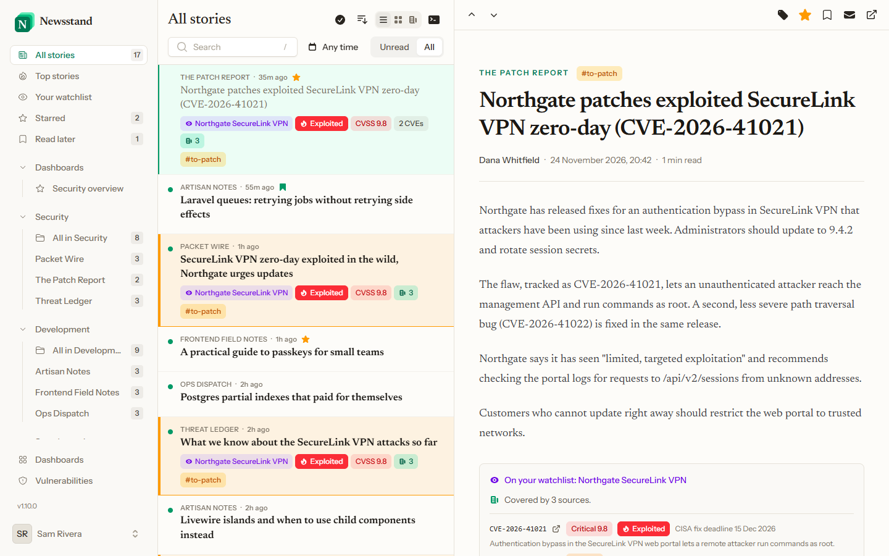
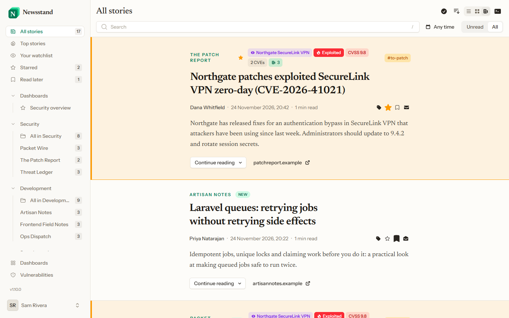
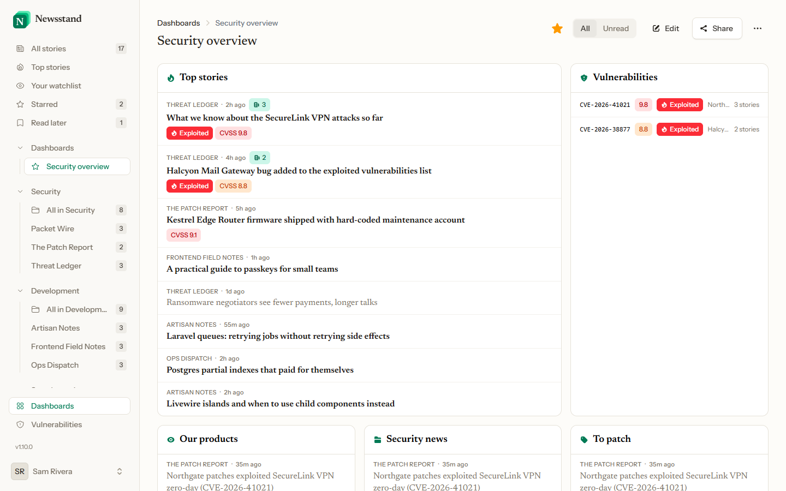
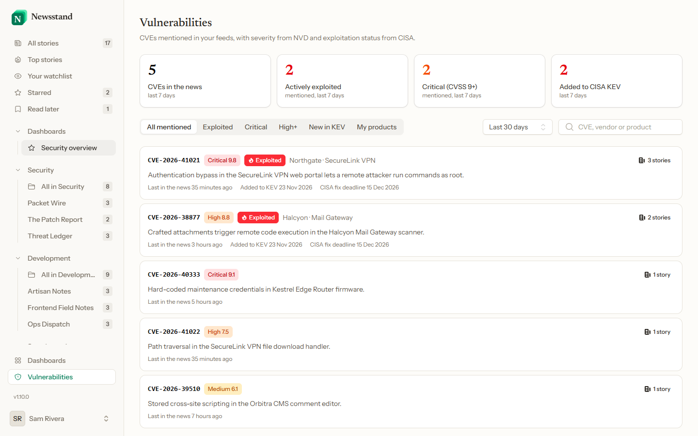
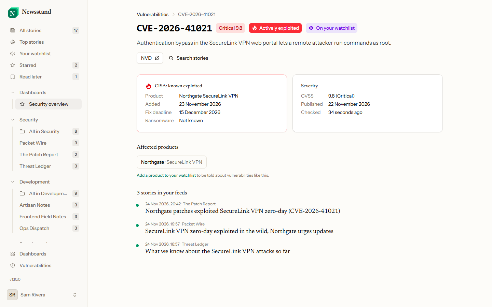
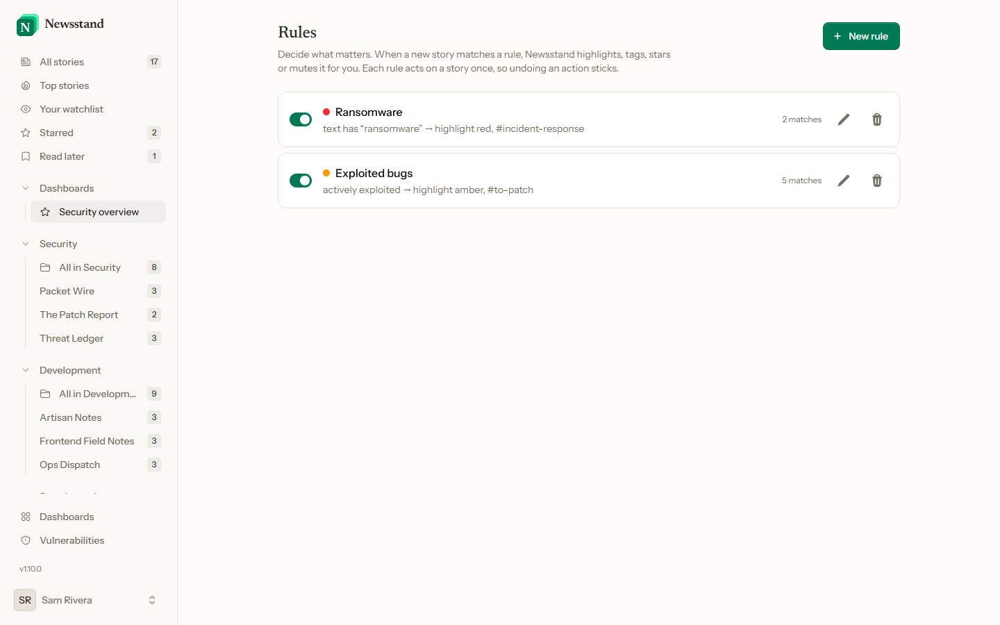
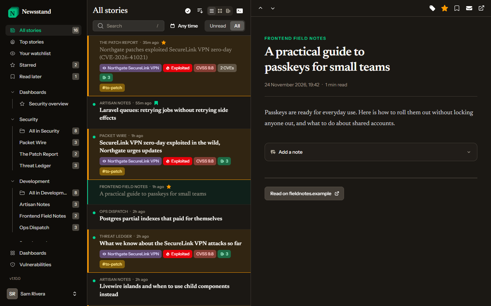
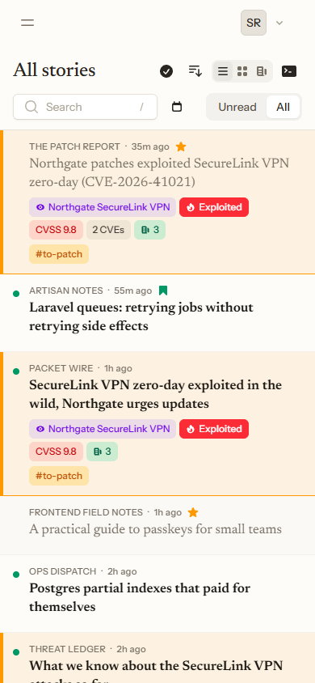

# Newsstand

A self-hosted RSS reader for tech and security news. Follow feeds in folders, read in a calm
editorial reader, and let Newsstand surface what matters: actively exploited vulnerabilities,
critical CVEs, stories many sources are covering, and anything your own rules flag. Share
dashboards with colleagues or publish them as a read-only page.

Built with Laravel 13, Livewire 4 and Flux. Runs on PostgreSQL (recommended), MySQL/MariaDB or SQLite.



## Screenshots

The screenshots use sample data with fictional outlets, vendors and CVEs (see [Sample data](#sample-data)).

| | |
|---|---|
|  |  |
| **River**: scroll through previews; stories are marked read as they pass | **Dashboards**: widgets for top stories, CVEs, your products and tags |
|  |  |
| **Vulnerabilities** mentioned in your feeds, with NVD scores and CISA KEV status | **CVE page**: exploitation, severity, affected products and every story about it |
|  |  |
| **Rules**: highlight, tag, star or mute what matches | **Dark mode** |

<p align="center"></p>

## Features

- **Feeds**: subscribe by site or feed URL (auto-discovery), folders with drag and drop, OPML import/export,
  per-feed health, full-text fetching for summary-only feeds, adaptive polling with backoff.
- **Reader**: list, card and river views; keyboard shortcuts (`?` shows them); star, read later, tags;
  full-text search (PostgreSQL: phrases, `-exclude`, `OR`) with saved searches in the sidebar; time filters;
  newest or oldest first; mark everything, or only what is older than a day or a week, as read.
- **Security signals**: CVEs extracted from every story, CVSS scores from NVD, exploitation status from
  CISA's Known Exploited Vulnerabilities catalog; a Vulnerabilities page; Top stories ranked by coverage and severity.
- **Watchlist**: the vendors and products you run; stories and CVEs that affect them are flagged, with a CVE page
  per vulnerability (scores, exploitation, affected products, every story about it).
- **Rules**: "when a story matches … then highlight / tag / star / save / mark read / mute", with presets for
  exploited and critical vulnerabilities. Teams have rules too: they run on the team's feeds and add a team tag,
  highlight for everyone or alert the team's channels.
- **Dashboards**: widget pages (feeds, folders, searches, tags, top stories, vulnerabilities) in three widths,
  shared with other users as viewer or editor, or published as a public read-only link. Each viewer keeps their own
  read state. Team dashboards belong to the team: they use the team's feeds, its owners and admins manage them, and
  they stay when their creator leaves.
- **Alerts** as push notifications, or to email, ntfy, Gotify, Slack, Teams or Discord: for watchlist stories,
  watched products newly exploited (CISA KEV), and rule matches. Never more than once per story per channel; bursts
  arrive as one summary. Push goes to every device you turn it on for in Settings → Alerts (a team's push channel
  reaches every member's devices).
- **Teams**: shared feed folders, shared tags, team rules, a team watchlist with team alert channels, team
  dashboards and notes on stories, with owner / admin / member roles and expiring invite links. Read state stays
  personal.
- **Daily digest** email, opt-in per user.
- **Installable app (PWA)**: install Newsstand from the browser on desktop or phone ("Install app" in the user
  menu); it opens on the reader, with shortcuts to Dashboards and Security, tells you when a new version is ready,
  and shows an offline page without a connection. Share a link to Newsstand from your phone to subscribe to that
  site. Pages are never cached on the device, only the app's static files. Needs HTTPS (or `localhost`).

## Local development

Requirements: PHP 8.4+, Composer, Node 24+.

```bash
composer install
npm install
cp .env.example .env && php artisan key:generate
touch database/database.sqlite   # or use the Docker stack below for PostgreSQL
php artisan migrate --seed       # creates test@example.com / password
composer run dev                 # app, queue worker, logs and Vite
```

The scheduler fetches feeds every minute; in development run it alongside: `php artisan schedule:work`.

**Docker (PostgreSQL + Redis):** `docker compose up -d` uses `compose.yaml` (Laravel Sail). On Windows, call
`docker compose` directly, or use the `sail` script from WSL2.

**Push notifications on Windows PHP:** PHP's OpenSSL on Windows can't make the keys push needs until the
`OPENSSL_CONF` environment variable points to the `openssl.cnf` PHP ships with, for example
`setx OPENSSL_CONF "C:\php\extras\ssl\openssl.cnf"` (then open a new terminal). Without it, Settings → Alerts says
push isn't available, and the two push tests that encrypt for real are skipped. Docker and Linux need nothing.

### Tests

```bash
php vendor/bin/pest                    # SQLite in memory (fast)
docker compose exec -e DB_CONNECTION=pgsql -e DB_HOST=pgsql -e DB_DATABASE=testing \
  -e DB_USERNAME=sail -e DB_PASSWORD=password laravel.test php vendor/bin/pest   # PostgreSQL
php vendor/bin/phpstan analyse         # static analysis (Larastan)
```

The test suite refuses to run against a non-test database. If it complains, you probably cached the config:
run `php artisan optimize:clear`.

Browser checks (Playwright, against a running dev server) live in `tests/Browser`; see its README.

### Sample data

`DemoSeeder` fills an empty database with one user, six fictional feeds, stories, CVEs, a watchlist item, rules,
tags and a dashboard, all processed the way real stories are (CVE extraction, story groups, rules). It refuses to
run on a database that has other users. Use a throwaway database, never your own:

```bash
touch /tmp/newsstand-demo.sqlite
DB_DATABASE=/tmp/newsstand-demo.sqlite php artisan migrate --force
DB_DATABASE=/tmp/newsstand-demo.sqlite php artisan db:seed --class=DemoSeeder --force
DB_DATABASE=/tmp/newsstand-demo.sqlite php artisan serve --port=8011   # sign in as demo@newsstand.test / demo-password
node tests/Browser/screenshots.mjs http://127.0.0.1:8011               # refreshes docs/screenshots
```

## Production

The image is published on Docker Hub as [`burnacid/newsstand`](https://hub.docker.com/r/burnacid/newsstand)
(tags `1.0.0`, `1.0`, `1`, `latest`; amd64). The compose stack runs it as the app, a Horizon queue worker and
the scheduler, with PostgreSQL and Redis. You only need `docker-compose.production.yml` and `.env.production.example`
from this repository.

```bash
cp .env.production.example .env.production
# edit .env.production: APP_URL, DB_PASSWORD, mail settings…
docker compose --env-file .env.production -f docker-compose.production.yml run --rm --no-deps --entrypoint php app artisan key:generate --show
# put the key in .env.production as APP_KEY, then:
docker compose --env-file .env.production -f docker-compose.production.yml up -d
```

Pin a version with `NEWSSTAND_IMAGE_TAG=1.0.0` in `.env.production` (default: `latest`). To build from a checkout
instead, add `--build`. Upgrading: `docker compose ... pull && docker compose ... up -d`; see [CHANGELOG.md](CHANGELOG.md).

The app listens on port `8080` (`APP_PORT`). Put a TLS-terminating reverse proxy in front of it
(Caddy, Traefik, nginx, Cloudflare Tunnel) and set `TRUSTED_PROXIES`. Database migrations run automatically
when the app container starts.

**First user:** with `NEWSSTAND_REGISTRATION=closed` (the production default) only the first account can sign
up; that's you, and the first account is the administrator. With `disabled` nobody can sign up, not even the first
account. Admins manage everything under **Administration** in the sidebar (users, registration, system health, and
the Horizon queue dashboard at `/horizon`). From the command line:

```bash
docker compose --env-file .env.production -f docker-compose.production.yml exec -u www-data app php artisan newsstand:user colleague@example.com --name="Colleague"
docker compose --env-file .env.production -f docker-compose.production.yml exec -u www-data app php artisan newsstand:admin you@example.com
```

**Storage:** `/app/storage` can be a named volume (the default) or a host folder (`./storage:/app/storage`).
The container prepares it on start: it creates Laravel's folders and gives them to `www-data` (uid 33), then
runs as that user. Run one-off commands as that user too: `docker compose ... exec -u www-data app php artisan ...`.

**Backups:** everything lives in the `pgdata` volume. For example, nightly:

```bash
docker compose --env-file .env.production -f docker-compose.production.yml exec -T pgsql \
  pg_dump -U newsstand newsstand | gzip > newsstand-$(date +%F).sql.gz
```

Feed content can always be fetched again; what matters in a backup is users, subscriptions, read state, tags,
rules and dashboards.

**MySQL / MariaDB:** set `DB_CONNECTION=mysql` or `mariadb`. Everything works; search uses simple text
matching instead of PostgreSQL's full-text index.

## Configuration

All Newsstand settings are in `config/newsstand.php`, most with an environment variable:

| Variable | Default | What it does |
|---|---|---|
| `NEWSSTAND_REGISTRATION` | `open` | `closed`: only the first account can register; `disabled`: nobody can (use `newsstand:user`) |
| `NEWSSTAND_USER_AGENT` | `Newsstand/1.0 (+self-hosted RSS reader)` | How Newsstand identifies itself to sites |
| `NEWSSTAND_BLOCK_PRIVATE_HOSTS` | `true` | Refuse feeds on private / LAN addresses (SSRF protection) |
| `NEWSSTAND_RETENTION_DAYS` | `90` | Delete older stories nightly (starred, saved, tagged and annotated are kept) |
| `NEWSSTAND_UNREAD_MAX_AGE_DAYS` | `30` | Older stories never count as unread |
| `NVD_API_KEY` | none | Higher NVD rate limits for CVSS lookups ([request one](https://nvd.nist.gov/developers/request-an-api-key)) |
| `NEWSSTAND_KEV_URL` | CISA's official GitHub copy | Source of the Known Exploited Vulnerabilities catalog |
| `NEWSSTAND_ALERTS_ALLOW_PRIVATE` | `false` | Allow alert channels on LAN addresses (self-hosted ntfy/Gotify); also under Administration → Settings |
| `NEWSSTAND_PUSH_PUBLIC_KEY`, `NEWSSTAND_PUSH_PRIVATE_KEY` | generated | Push notification keys. Left empty, a pair is generated once and stored encrypted with `APP_KEY`; set them (`php artisan push:keys`) to keep them across a new `APP_KEY` or server. Changing them means turning push on again on every device |
| `NEWSSTAND_PUSH_SUBJECT` | `mailto:` + `MAIL_FROM_ADDRESS` | Contact address push services see |
| `APP_TIMEZONE` | `UTC` | Used for digest delivery times |
| `TRUSTED_PROXIES` | none | Reverse proxy addresses, or `*` |

## Useful commands

| Command | What it does |
|---|---|
| `php artisan feeds:refresh {id?} --all` | Fetch feeds now (due feeds by default) |
| `php artisan security:sync-kev` | Import CISA's KEV catalog (runs daily) |
| `php artisan security:enrich [--all]` | Queue NVD lookups for scores and affected products (runs hourly) |
| `php artisan signals:process --days=7` | Extract CVEs, group stories and run rules for stories not processed yet (`--days=2` runs hourly) |
| `php artisan digest:send --user=you@example.com --force` | Send a digest now |
| `php artisan newsstand:user email [--admin]` | Create a user |
| `php artisan newsstand:admin email [--revoke]` | Grant or remove administrator rights |
| `php artisan entries:prune` | Delete old stories (runs nightly) |
| `php artisan scheduler:check` | Fail when the scheduler has not run in the last 3 minutes (used by the container health check) |
| `php artisan alerts:retry-pending` | Queue delivery again for alerts pending over 15 minutes (runs every 15 minutes) |

## Security notes

- Article HTML from feeds is sanitized before it's stored; images load without a referrer.
- Server-side fetches are protected against SSRF: http(s) only, private and reserved addresses refused
  (including after redirects, IPv4-mapped IPv6, NAT64 and carrier-grade NAT), the connection pinned to the
  checked address (no DNS rebinding), response size capped (also for chunked responses).
- Some sites block automated readers (cisa.gov, for example). Newsstand says so instead of disguising itself.
- Public dashboard links show headlines only, are random 40-character tokens, can be revoked, and are rate limited.
